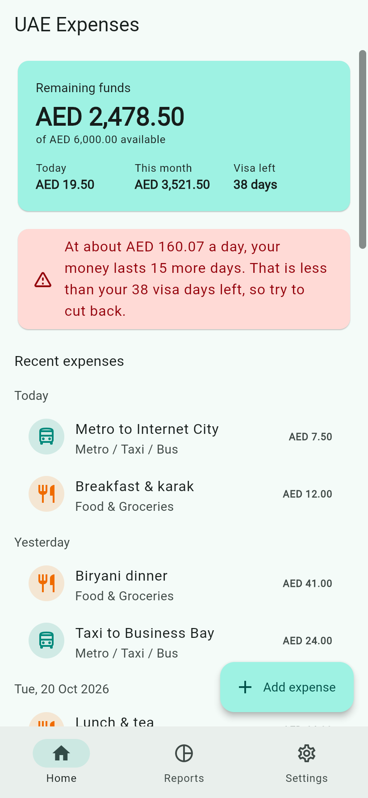
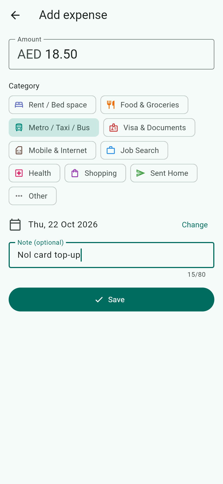
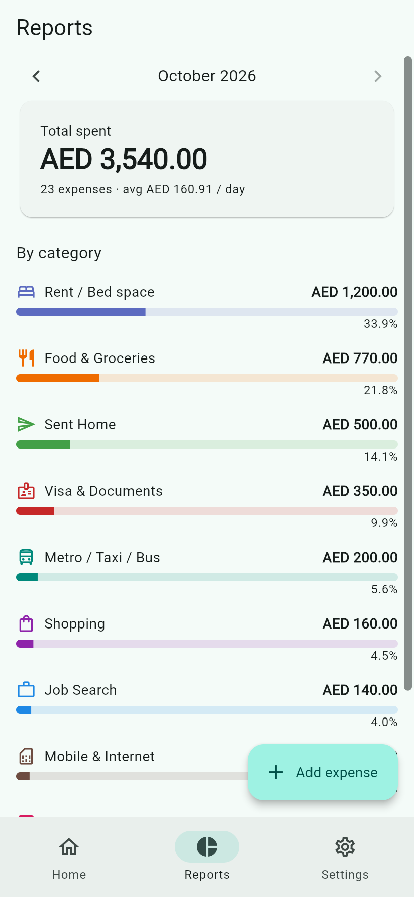
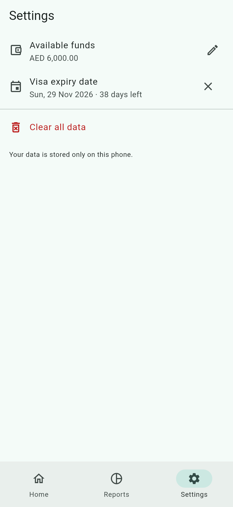

# Expense Tracker

A simple expense tracker for people living abroad on a visit visa while job hunting — works in any country and currency.
Record what you spend in your own currency and see how long your money will last compared with the days left on your visa.

<p>
  
  
  
  
</p>

Demo video: [media/uae_expenses_demo.mp4](media/uae_expenses_demo.mp4)

## Features

- **Dashboard**: remaining funds, today's and this month's spending, and visa days left.
- **Insight card**: warns you when your money will run out before your visa does.
- **Quick entry**: amount in your chosen currency (56 supported), categories such as rent/housing, food, transport, visa fees, job search and money sent home.
- **Monthly reports**: spending by category with percentages.
- **Any currency**: pick yours in Settings; new installs default to the phone's region.
- **Private**: all data stays on the phone. No account, no internet needed.

## Development

```
flutter pub get
flutter run
```

Regenerate the app icon after changing `assets/icon/`:

```
dart run flutter_launcher_icons
```

## Release (Android)

Release builds are signed with the upload key described in `android/key.properties`.
That file and the keystore are not in git; without them the release build falls back to debug keys.

`android/key.properties`:

```
storePassword=<password>
keyPassword=<password>
keyAlias=upload
storeFile=<path to upload keystore .jks>
```

Bump `version` in `pubspec.yaml` (e.g. `1.0.1+2`) for each release, then:

```
flutter build appbundle --release   # build/app/outputs/bundle/release/app-release.aab (Google Play)
flutter build apk --release         # build/app/outputs/flutter-apk/app-release.apk (direct install)
```
